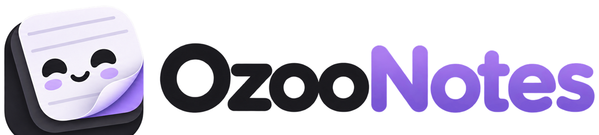
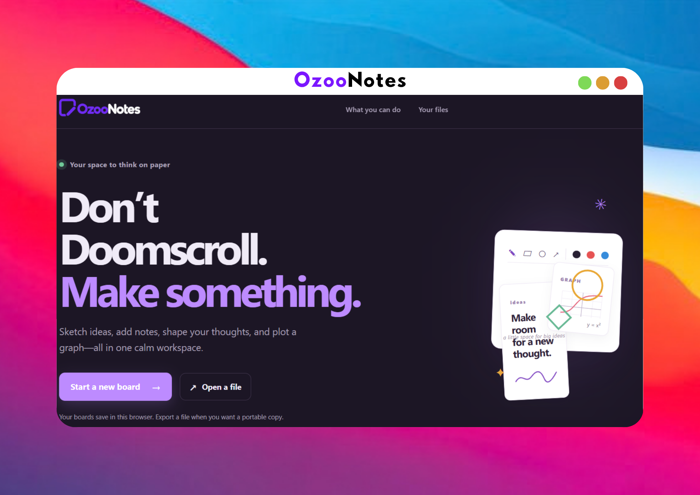

# OzooNotes

**A little space for big ideas.** OzooNotes is a visual notes and whiteboard app for students, teachers, and anyone who thinks better by combining writing, drawing, and planning on the same page.

## Try OzooNotes

### [Open the app](https://AMStudios6.github.io/ozoonotes/)

No installation or account is needed to start. Open the site, choose a student or teacher workspace, pick a page size and starter, and begin.

## Why use OzooNotes?

Many ideas need more than a plain text box. A lesson can make more sense beside a diagram; a programming concept can click when the code and explanation sit together; a plan can be easier to follow when tasks, sketches, and notes live on one page.

OzooNotes gives you one flexible paper-like workspace for those mixed notes. Start with a template when you want structure, or choose a blank board when you want room to explore. Keep your work on multiple pages, arrange it for the way you think, and export a copy when it is ready to print or share.

- **Think visually:** combine handwriting, typed text, shapes, images, diagrams, and graphs on a page.
- **Learn by connecting ideas:** use templates such as Cornell notes, coding notes, concept maps, worksheets, and lesson plans to put explanations beside examples.
- **Start faster:** choose a student or teacher starter, page format, and template instead of setting up every page from scratch.
- **Organize your work:** group boards into notebooks and add tags so class notes, projects, links, plans, and quick thoughts are easier to find.
- **Keep control of your files:** boards save in this browser on this device. Export a PDF for printing, PNG or SVG for sharing, or an OzooNotes file for a portable backup.
- **Make it comfortable:** choose portrait or landscape, select from common paper sizes, and switch between color themes.

## What you can make

### Notes, study guides, and coding notes

Write or sketch with the brush, pencil, pen, and marker. Add typed notes, highlight important details, and use ready-made layouts. The coding-notes template puts a theory and explanation area alongside numbered code lines, with room below to record output and tests.

### Diagrams, graphs, and visual plans

Arrange shapes and images, map relationships between concepts, build a mood board, or plot equations and data points with the graph tools.

### Multi-page work

Create boards with pages in A1, A2, A3, A4, A5, Letter, Legal, or Tabloid size. Set page orientation to portrait or landscape, add pages as your work grows, and export selected pages as PDF.

### Student and teacher spaces

Student starters support class notes, study guides, concept maps, planners, and more. Teacher starters include lesson plans, worksheets, rubrics, exit tickets, seating charts, and code walkthroughs.

## Saving and privacy

The hosted app saves boards and recent files in your browser storage on this device. That makes it quick to reopen work without an account, but browser data is not the same as a backup: export an OzooNotes file to keep a copy or move it to another device. Export pages as PDF, PNG, or SVG when you need a printable or shareable version.

The repository also includes an optional self-hosted server and account features for people who want to run their own service. The public GitHub Pages version is configured for local-only use.

## Windows desktop app

OzooNotes can also run as an independent Windows desktop app. The packaged app opens the live GitHub Pages site in its own window and refreshes its web cache at launch. After a GitHub Pages deployment completes, the app loads the updated website the next time it starts. An internet connection is required to use the desktop app.

Boards are saved in the desktop app's local browser storage on this device, separate from files saved in a regular browser. Exports such as PDF open the Windows Save dialog.

To run it in development, install dependencies and run `npm run desktop:dev`. To build the installer and portable executable on Windows, run `npm run desktop:dist`; the `.exe` files will be written to `release/`. The installer contains the desktop shell rather than a bundled copy of the website, so it follows the hosted app as it is updated.

You can also build it from GitHub: open **Actions → Build OzooNotes for Windows → Run workflow**, then download the **OzooNotes-Windows** artifact from the completed run. Tagged releases named `desktop-v*` run the same build automatically. The Windows executable is currently unsigned, so Windows may show a SmartScreen warning when it is first opened.

## Run locally

Use Node.js 24 or newer.

1. Run `npm ci`.
2. Run `npm run dev` and open the Vite URL it prints.

The API server is optional for local editing. To develop the server-backed features, run `npm run server` in another terminal. It stores account and board data in `data/doomnotes.sqlite`.

## Deploy to GitHub Pages

The repository's GitHub Actions workflow builds the static app and publishes it to Pages. It sets the project-site base path and enables local-only mode automatically. In repository **Settings → Pages**, select **GitHub Actions** as the build and deployment source if it is not already selected.

The site URL is [https://AMStudios6.github.io/ozoonotes/](https://AMStudios6.github.io/ozoonotes/).

## Build

Run `npm run build` to build the website into `dist/`.

